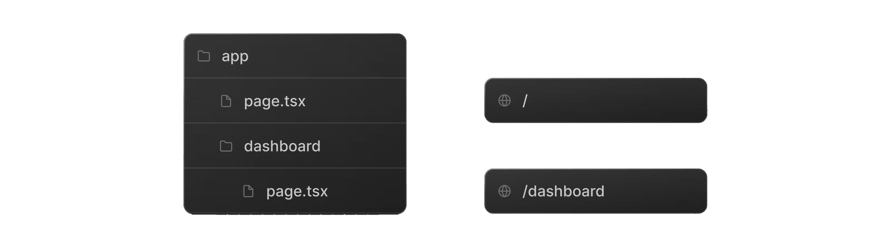
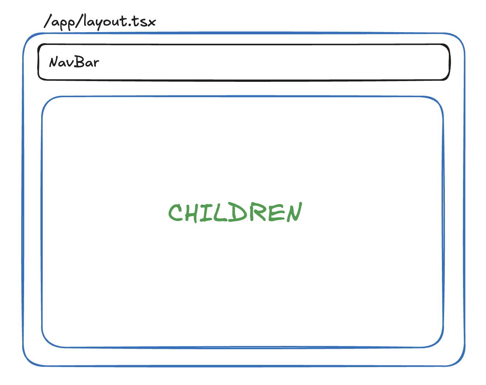
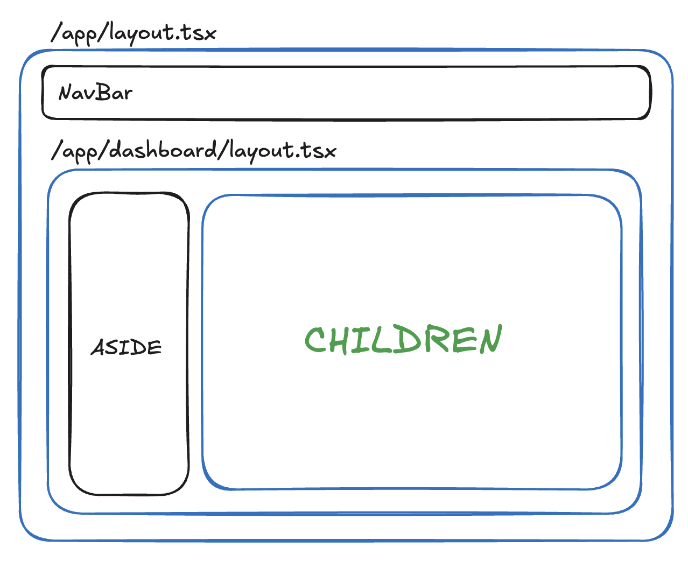

# Routing

Tot nu toe bestonden onze applicaties uit één enkele pagina. Dit is niet erg handig als je een volledige website wil maken. Daarom is er een manier nodig om meerdere pagina's te maken. Dit kan met behulp van een router. Een router is een stukje code dat bepaalt welke pagina getoond moet worden op basis van de URL. 

In het onderdeel React.js hebben we routes gedefinieerd met behulp van de bibliotheek React Router (in data mode). Je beschrijft dan in je code, met een array van route objecten, welke componenten bij welke URL's horen. Dit is een goede manier om routes te definiëren, maar het heeft als nadeel dat je een aanzienlijke hoeveelheid code moet schrijven om de router te configureren. 

## File-system based router

Next.js maakt gebruik van een zogenaamde "file-system based" router. Dit betekent dat we geen extra code moeten schrijven om de router te configureren. We moeten enkel een aantal bestanden en directories aanmaken en de router zal automatisch de juiste pagina tonen op basis van het pad. 

Als je een nieuw Next.js project aanmaakt met `npx create-next-app@latest`, dan zal er automatisch een `app` directory aangemaakt worden. In deze directory kan je nieuwe bestanden en directories aanmaken om nieuwe routes te maken. Er wordt ook al een `page.tsx` bestand aangemaakt in de `app` directory. 

### Nieuwe routes maken

Als je bijvoorbeeld een pagina wilt aanbieden op het pad `/about`, dan kan je een nieuwe directory `about` aanmaken in de `app` directory en daar een nieuw bestand `page.tsx` aanmaken. Je kan hier zo diep gaan als je zelf wil. Wil je bijvoorbeeld een pagina aanbieden op het pad `/dashboard/invoices`, dan kan je een directory `dashboard` aanmaken in de `app` directory en daar een nieuwe directory `invoices` aanmaken. In deze directory kan je dan een nieuw bestand `page.tsx` aanmaken. 



### Link component

Om te navigeren tussen de verschillende pagina's kan je gebruik maken van het `Link` component dat meegeleverd wordt met Next.js. Dit component zorgt ervoor dat de navigatie gebeurt zonder dat de pagina volledig herladen wordt. Dit zorgt voor een betere gebruikerservaring. Als je gewoon een `<a>` element gebruikt, dan zal de pagina volledig herladen worden. 

Als we bijvoorbeeld een navigatiebalk willen maken die op de root pagina getoond wordt, dan kunnen we een nieuwe component `NavBar` maken en deze toevoegen aan het `layout.tsx` bestand in de `app` directory. 

```typescript
import Link from "next/link";

const NavBar = () => {
  return (
    <nav>
      <Link href="/">Home</Link>
      <Link href="/about">About</Link>
      <Link href="/dashboard/invoices">Invoices</Link>
    </nav>
  );
};
```

Je kan in principe zelf kiezen waar je de `NavBar` component aanmaakt in de directory structuur van je project. Je kan deze bijvoorbeeld in een `components` directory naast de `app` directory plaatsen. Er wordt ook vaak gekozen om de componenten bij de pagina's te plaatsen waar ze gebruikt worden. In dit geval zou je de `NavBar` component in de `app` directory kunnen plaatsen.

#### Active links

Om aan te geven welke link actief is, kan je gebruik maken van de `usePathname` hook die meegeleverd wordt met Next.js. Deze hook geeft de huidige pathname terug. Je kan deze gebruiken om te bepalen welke link actief is en deze een andere stijl te geven. Deze werkt enkel in client componenten, dus meestal zijn navigatiebalken client componenten.

```typescript
"use client";

import Link from "next/link";
import { usePathname } from "next/navigation";

interface NavLinkProps {
  href: string;
  label: string;
}

const NavLink = ({href, label} : NavLinkProps) => {
  const pathname = usePathname();
  return (
    <Link href={href} className={`px-3 py-2 rounded-md text-sm font-medium ${pathname === href ? "bg-blue-600 text-white" : "text-gray-700 hover:bg-gray-200 hover:text-black"}`}>
        {label}
    </Link>
  )
}

const NavBar = () => {
  return (
    <nav>
      <NavLink href="/" label="Home" />
      <NavLink href="/about" label="About" />
      <NavLink href="/dashboard/invoices" label="Invoices" />
    </nav>
  );
};

export default NavBar;
```

### Layouts maken

Je kan ook gebruik maken van layouts om gedeelde componenten te maken die op meerdere pagina's gebruikt worden. Dit is handig als je bijvoorbeeld een navigatiebalk of een footer wil maken die op alle pagina's getoond wordt. Je kan dit doen door een nieuw bestand `layout.tsx` aan te maken in de directory waar je de layout wil gebruiken. Dus als je een layout wil maken die op alle pagina's gebruikt wordt, dan kan je een nieuw bestand `layout.tsx` aanmaken in de `app` directory. 

```
app/layout.tsx → layout voor alle pagina's
``` 

Elke nieuwe Next.js applicatie die je aanmaakt met `npx create-next-app@latest` heeft al een `layout.tsx` bestand in de `app` directory. Vereenvoudigd ziet dit bestand er als volgt uit:

```typescript
const RootLayout = ({ children }: LayoutProps<"/">) => {
  return (
    <html lang="en">
      <body>{children}</body>
    </html>
  );
};

export default RootLayout;
```

Je ziet hier dat de layout een component is die een `children` prop verwacht. Deze prop bevat de inhoud van de pagina die getoond moet worden. In dit geval wordt de inhoud van de pagina in de `body` van het HTML document geplaatst.

Het type `LayoutProps<"/">` is hier gelijk aan `{ children: React.ReactNode }`. Net zoals `PageProps` (zie verder bij dynamische routes) hoef je het niet te importeren: Next.js genereert het automatisch voor elke route wanneer `npm run dev` of `npm run build` draait. Tussen de `<...>` staat het pad van de layout. Omdat Next.js de types afleidt uit je bestanden, krijg je meer type safety: een layout in een dynamische route krijgt bijvoorbeeld meteen de juiste `params`, en een fout pad geeft een rode lijn in je editor.

Wil je bijvoorbeeld op elke pagina een navigatiebalk tonen, dan kan je dit doen door de navigatiebalk component toe te voegen aan de layout:

```typescript
import { Suspense } from "react";
import NavBar from "@/components/NavBar";

const RootLayout = ({ children }: LayoutProps<"/">) => {
  return (
    <html lang="en">
      <body>
        <Suspense fallback={<nav className="h-10" />}>
          <NavBar />
        </Suspense>
        {children}
      </body>
    </html>
  );
};

export default RootLayout;
```

Omdat onze `NavBar` de `usePathname` hook gebruikt om de actieve link aan te duiden, zetten we hem in een `Suspense` component. Op pagina's met een dynamisch pad (zoals `/products/3`, zie verder) kent Next.js de URL pas wanneer de gebruiker de pagina opvraagt. Zonder `Suspense` krijg je dan een foutmelding zoals `Next.js encountered URL data usePathname() in a Client Component outside of <Suspense>`. Met de `fallback` (hier een lege balk met dezelfde hoogte) kan Next.js de rest van de pagina al op voorhand klaarzetten.



Je kan ook geneste layouts maken. Dit is handig als je bijvoorbeeld een layout wil maken die alleen op bepaalde pagina's gebruikt wordt. Wil je bijvoorbeeld een layout maken die alleen op de dashboard pagina's gebruikt wordt, dan kan je een nieuw bestand `layout.tsx` aanmaken in de `app/dashboard` directory. 

```
app/dashboard/layout.tsx → layout voor alle dashboard pagina's
```

Stel je voor dat we een speciale layout willen maken voor alle dashboard pagina's. Deze layout kan er als volgt uitzien:

```typescript
import SideBar from "@/components/SideBar";

const DashboardLayout = ({ children }: LayoutProps<"/dashboard">) => {
  return (
    <div style={{ display: "flex" }}>
      <SideBar />
      <div>
        {children}
       </div>
    </div>
  );
};

export default DashboardLayout;
```

Merk hierbij op dat eerst de layout in de `app` directory wordt toegepast en daarna de layout in de `app/dashboard` directory. Dit betekent dat de `NavBar` component altijd getoond wordt, ook op de dashboard pagina's.

Als je naar /dashboard/invoices navigeert, dan zal de volgende structuur getoond worden:



### Imperatieve navigatie

In sommige gevallen wil je misschien imperatief navigeren naar een andere pagina. Dit kan bijvoorbeeld handig zijn na het indienen van een formulier. In een client component kan je hiervoor de `useRouter` hook gebruiken die meegeleverd wordt met Next.js. Deze hook geeft een router object terug waarmee je kan navigeren.

```typescript
"use client";

import { useRouter } from "next/navigation";

const MyComponent = () => {
  const router = useRouter();

  const handleClick = () => {
    router.push("/about");
  };

  return (
    <button onClick={handleClick}>Go to About Page</button>
  );
};
export default MyComponent;
```

Je hebt ook nog de volgende methodes beschikbaar op het router object:
- `replace(href: string)`: Navigeert naar de opgegeven URL, maar vervangt de huidige entry in de geschiedenis in plaats van een nieuwe entry toe te voegen.
- `back()`: Navigeert terug naar de vorige pagina in de geschiedenis.
- `forward()`: Navigeert vooruit naar de volgende pagina in de geschiedenis.
- `refresh()`: Vernieuwt de huidige pagina: de server components worden opnieuw gerenderd en hun data wordt opnieuw opgehaald. De state van client componenten blijft behouden. Data die je zelf gecachet hebt met `"use cache"` blijft wel in de cache (zie [Extra: data cachen](./cache-components.md)).


### Dynamische routes

Je kan ook dynamische routes maken. Dit is handig als je bijvoorbeeld een pagina wil maken die de details van een bepaald item toont. Stel je voor dat we een pagina hebben die een lijst van producten toont. Als je op een product klikt, wil je naar een pagina navigeren die de details van dat product toont. 

Stel dat we een lijst van producten hebben zoals hieronder:

```typescript
interface Product {
  id: number;
  name: string;
}

const products : Product[] = [
  { id: 1, name: "Product 1" },
  { id: 2, name: "Product 2" },
  { id: 3, name: "Product 3" },
];

export default products;
```

We kunnen dan een nieuwe pagina maken die de lijst van producten toont. Dit kan in het bestand `app/products/page.tsx`:

```typescript
import Link from "next/link";
import products from "@/data/products";

const ProductsPage = () => {
  return (
    <div>
      <h1>Products</h1>
      <ul>
        {products.map((product) => (
          <li key={product.id}>
            <Link href={`/products/${product.id}`}>{product.name}</Link>
          </li>
        ))}
      </ul>
    </div>
  );
};

export default ProductsPage;
```

We gaan hier uiteraard geen drie aparte pagina's maken voor elk product. In plaats daarvan gaan we een dynamische route maken. Dit kan door een nieuwe directory aan te maken in de `app/products` directory met de naam `[id]`. De naam tussen de vierkante haken geeft aan dat dit een dynamische parameter is. In deze directory kunnen we dan een nieuw bestand `page.tsx` aanmaken. 

```typescript
const ProductsDetail = async(props: PageProps<"/products/[id]">) => {
    const { id } = await props.params;

    return (
        <div className="p-4">
            <h1 className="text-2xl font-bold mb-4">Product Detail for ID: {id}</h1>
            <p className="text-lg">This is the detail page for product with ID {id}.</p>
        </div>
    );
}

export default ProductsDetail;
```

Merk op dat we hier een speciaal type `PageProps` gebruiken om de props van de pagina te typeren. Dit type wordt meegeleverd door Next.js en zorgt ervoor dat we toegang hebben tot de dynamische parameters in de URL. Je moet het niet importeren: Next.js genereert het automatisch voor elke route wanneer `npm run dev` of `npm run build` draait. Krijg je toch een rode lijn in je editor, start dan even de development server. In dit geval is er één parameter `id` die we kunnen gebruiken om de details van het product op te halen. Omdat het ophalen van parameters in Next.js asynchroon is, maken we de component `async` en gebruiken we `await` om de parameters op te halen.

De waarde van `id` is pas gekend wanneer de gebruiker de pagina opvraagt. Net zoals bij het ophalen van data moet je dus een `loading.tsx` naast deze pagina zetten (of in `app/products`, dan geldt hij voor beide pagina's). Anders krijg je de foutmelding `Next.js encountered uncached or runtime data during prerendering`.

Als je deze wil uitlezen in een client component, dan kan je gebruik maken van de `useParams` hook die meegeleverd wordt met Next.js. Deze hook geeft een object terug met de dynamische parameters.

```typescript
"use client";

import { useParams } from "next/navigation";

const ProductDetailClient = () => {
  const { id } = useParams<{ id: string }>();

  return (
    <div>
      <h1>Product Detail for ID: {id}</h1>
      <p>This is the detail page for product with ID {id}.</p>
    </div>
  );
};
export default ProductDetailClient;
```

Met `useParams<{ id: string }>()` geef je aan welke parameters je verwacht, zodat `id` het type `string` krijgt.

### not-found.tsx

Met een `not-found.tsx` bestand in de `app` directory maak je een custom 404 pagina. Next.js toont die pagina voor elke URL die niet bestaat in je applicatie.

```typescript
const NotFound = () => {
  return (
    <div>
      <h1>404 - Page Not Found</h1>
      <p>The page you are looking for does not exist.</p>
    </div>
  );
};
export default NotFound;
```

Als je ervoor wil zorgen dat een bepaalde pagina de 404 pagina toont, kan je de `notFound` functie aanroepen die meegeleverd wordt met Next.js. Deze functie zorgt ervoor dat de 404 pagina getoond wordt. Zo kunnen we op de detailpagina een 404 tonen als het product niet bestaat:

```typescript
import { notFound } from "next/navigation";
import products from "@/data/products";

const ProductsDetail = async (props: PageProps<"/products/[id]">) => {
  const { id } = await props.params;
  const product = products.find((product) => product.id === Number(id));

  if (!product) {
    notFound();
  }

  return (
    <div className="p-4">
      <h1 className="text-2xl font-bold mb-4">{product.name}</h1>
      <p className="text-lg">This is the detail page for product with ID {id}.</p>
    </div>
  );
};

export default ProductsDetail;
```

Omdat `notFound()` de uitvoering van de pagina stopt, weet TypeScript dat `product` na de `if` zeker bestaat.

Wil je voor een deel van je applicatie een andere 404 pagina, dan kan je ook een `not-found.tsx` in een subdirectory zetten, bijvoorbeeld `app/products/not-found.tsx`. Opgelet: die wordt enkel getoond wanneer je `notFound()` aanroept in een pagina binnen die directory. Een URL die helemaal niet bestaat (zoals `/products/abc/xyz`) toont altijd de `not-found.tsx` uit de `app` directory.

### Route groups

Je kan ook gebruik maken van route groups om je directory structuur overzichtelijker te maken. Dit is handig als je bijvoorbeeld een aantal pagina's hebt die bij elkaar horen, maar je wil niet dat deze pagina's een extra niveau in de URL krijgen. Je kan ook op deze manier gedeelde layouts maken voor een groep pagina's zonder dat dit invloed heeft op de URL structuur.

Je kan een route group maken door een directory aan te maken met de naam `(group-name)`. De naam tussen de ronde haken geeft aan dat dit een route group is. In deze directory kan je dan nieuwe bestanden en directories aanmaken zoals je normaal zou doen.

```
app/
├── layout.tsx             → root layout met <html> en <body> voor alle pagina's
├── (shop)/
│   ├── layout.tsx         → layout met NavBar voor alle shop pagina's
│   ├── page.tsx           → /
│   └── products/page.tsx  → /products
└── (auth)/
    ├── layout.tsx         → eenvoudige layout zonder NavBar
    └── login/page.tsx     → /login
```

De namen `(shop)` en `(auth)` komen niet in de URL terecht. Let op een paar dingen:

- De root layout `app/layout.tsx` blijft bestaan en bevat de `<html>` en `<body>` tags. De layouts in de groepen bevatten enkel wat er extra bij komt, net zoals de dashboard layout hierboven. De `NavBar` staat nu dus in `app/(shop)/layout.tsx` en niet meer in de root layout.
- Twee pagina's mogen niet naar hetzelfde pad leiden. Omdat `app/(shop)/page.tsx` nu de pagina voor `/` is, moet je `app/page.tsx` weghalen.

### Search parameters

#### Server component

In een pagina (`page.tsx`) kan je ook gebruik maken van search parameters (of query parameters). Dit zijn de parameters die in de URL staan na het vraagteken (`?`). Stel dat we een pagina hebben die een lijst van producten toont en we willen deze lijst filteren op basis van een zoekterm. We kunnen dan de zoekterm als een search parameter in de URL meegeven, bijvoorbeeld `/products?q=shirt`.

```typescript
import Link from "next/link";

interface Product {
  id: number;
  name: string;
}

const products : Product[] = [
  { id: 1, name: "Red Shirt" },
  { id: 2, name: "Blue Jeans" },
  { id: 3, name: "Green Hat" },
  { id: 4, name: "Yellow Jacket" },
  { id: 5, name: "Black Shoes" },
  { id: 6, name: "White Socks" },
];

const ProductsPage = async(props: PageProps<"/products">) => {
    const searchParams = await props.searchParams;
    const q = typeof searchParams.q === "string" ? searchParams.q : "";
    const filteredProducts = products.filter(product => product.name.startsWith(q));

    return (
      <div>
        <h1>Products</h1>
        <ul>
          {filteredProducts.map((product) => (
            <li key={product.id}>
              <Link href={`/products/${product.id}`}>{product.name}</Link>
            </li>
          ))}
        </ul>
      </div>
    );
}

export default ProductsPage;
```

Opgelet: de `searchParams` prop krijg je enkel in een pagina, niet in een layout of een ander component. Wil je ze in een ander component gebruiken, geef ze dan door als prop of gebruik `useSearchParams` (zie verder). Ook de search parameters zijn pas gekend wanneer de gebruiker de pagina opvraagt, dus ook hier hoort een `loading.tsx` naast de pagina.

#### Search parameters in client componenten

Om de search parameters te gebruiken in een client component, kan je gebruik maken van de `useSearchParams` hook die meegeleverd wordt met Next.js. Deze hook geeft een `URLSearchParams` object terug dat je kan gebruiken om de search parameters op te halen.

```typescript
"use client";

import { useRouter, useSearchParams } from "next/navigation";
import { FormEventHandler, useState } from "react";

const SearchBox = () => {
    const searchParams = useSearchParams();
    const { replace } = useRouter();
    const q: string = searchParams.get("q") ?? "";
    const [searchField, setSearchField] = useState<string>(q);

    const onSubmit : FormEventHandler<HTMLFormElement> = (e) =>{ 
        e.preventDefault();
        const params = new URLSearchParams(searchParams.toString());
        if (searchField !== "") {
            params.set("q", searchField)
        } else {
            params.delete("q");
        }

        replace(`?${params.toString()}`)
    }

    return (
        <div>
            <form onSubmit={onSubmit}>
                <input
                    className="border-2 border-black"
                    type="search"
                    value={searchField}
                    onChange={(e) => setSearchField(e.target.value)}
                />

                <button type="submit">Search</button>
            </form>
        </div>
    )
}

export default SearchBox;
```

Een component dat `useSearchParams` gebruikt, zet je altijd in een `Suspense` component. De search parameters zijn namelijk pas gekend wanneer de gebruiker de pagina opvraagt. Zonder `Suspense` krijg je de foutmelding `Next.js encountered URL data useSearchParams() in a Client Component outside of <Suspense>`. Opgelet: in development lijkt alles soms te werken, de fout komt dan pas bij `npm run build`.

```typescript
<Suspense fallback={<div className="h-10" />}>
    <SearchBox />
</Suspense>
```

#### Voorbeeld: Producten sorteren aan de hand van query parameters

We kunnen een client component maken die de sortering van producten aanpast op basis van query parameters in de URL. We maken hiervoor een `SortSelect` component die twee select elementen bevat: één voor het veld waarop gesorteerd wordt en één voor de richting van de sortering (oplopend of aflopend).

De mogelijke waarden leggen we vast met twee types in `types.ts` (in de root van je project):

```typescript title="types.ts"
export type SortField = "id" | "name";
export type SortDirection = "asc" | "desc";
```

```typescript title="components/SortSelect.tsx"
"use client";

import { useRouter, useSearchParams } from "next/navigation";
import { SortDirection, SortField } from "@/types";

const SortSelect = () => {
    const searchParams = useSearchParams();
    const { replace } = useRouter();

    const sortField : SortField = (searchParams.get("sortField") || "id") as SortField;
    const sortDirection : SortDirection = (searchParams.get("sortDirection") || "asc") as SortDirection;

    const onChangeSortField: React.ChangeEventHandler<HTMLSelectElement> = (e) => {
        const newSort = e.target.value;
        const params = new URLSearchParams(searchParams.toString());
        if (newSort) {
            params.set("sortField", newSort);
        } else {
            params.delete("sortField");
        }
        replace(`?${params.toString()}`);
    };

    const onChangeSortDirection: React.ChangeEventHandler<HTMLSelectElement> = (e) => {
        const newSort = e.target.value;
        const params = new URLSearchParams(searchParams.toString());
        if (newSort) {
            params.set("sortDirection", newSort);
        } else {
            params.delete("sortDirection");
        }
        replace(`?${params.toString()}`);
    };

    return (
        <div>
            <label htmlFor="sortField" className="mr-2 font-medium">Sort by:</label>
            <select id="sortField" name="sortField" className="border border-gray-300 rounded-md p-2" onChange={onChangeSortField} value={sortField}>
                <option value="id">ID</option>
                <option value="name">Name</option>
            </select>

            <label htmlFor="sortDirection" className="ml-4 mr-2 font-medium">Direction:</label>
            <select id="sortDirection" name="sortDirection" className="border border-gray-300 rounded-md p-2" onChange={onChangeSortDirection} value={sortDirection}>
                <option value="asc">Ascending</option>
                <option value="desc">Descending</option>
            </select>
        </div>
    );
}

export default SortSelect;
```

Deze kan je dan als volgt gebruiken om een lijst van producten te sorteren. Ook deze pagina gebruikt `searchParams`, dus zet er een `loading.tsx` naast:

```typescript
import Link from "next/link";
import { Suspense } from "react";
import SortSelect from "@/components/SortSelect";
import { SortDirection, SortField } from "@/types";

interface Product {
  id: number;
  name: string;
}

const products : Product[] = [
  { id: 1, name: "Red Shirt" },
  { id: 2, name: "Blue Jeans" },
  { id: 3, name: "Green Hat" },
  { id: 4, name: "Yellow Jacket" },
  { id: 5, name: "Black Shoes" },
  { id: 6, name: "White Socks" },
];

const ProductsPage = async(props: PageProps<"/products">) => {
    const searchParams = await props.searchParams;
    const sortField : SortField = (typeof searchParams.sortField === "string" ? searchParams.sortField : "id") as SortField;
    const sortDirection : SortDirection = (typeof searchParams.sortDirection === "string" ? searchParams.sortDirection : "asc") as SortDirection;

    const sortedProducts = products.toSorted((a, b) => {
        const fieldA = a[sortField];
        const fieldB = b[sortField];

        if (fieldA < fieldB) return sortDirection === "asc" ? -1 : 1;
        if (fieldA > fieldB) return sortDirection === "asc" ? 1 : -1;
        return 0;
    });

    return (
      <div>
        <h1>Products</h1>
        <Suspense>
          <SortSelect />
        </Suspense>
        <ul>
          {sortedProducts.map((product) => (
            <li key={product.id}>
              <Link href={`/products/${product.id}`}>{product.name}</Link>
            </li>
          ))}
        </ul>
      </div>
    );
}

export default ProductsPage;
```

#### Voorbeeld: Paginatie met query parameters

Terug naar het productenvoorbeeld: we kunnen ook een paginatie component maken die de pagina's toont op basis van een `page` query parameter in de URL.

```typescript title="components/Pagination.tsx"
"use client";

import { useSearchParams, useRouter } from "next/navigation";
interface PaginationProps {
    pageCount: number;
    currentPage: number;
}

const Pagination = ({ pageCount, currentPage }: PaginationProps) => {
    const searchParams = useSearchParams();
    const { replace } = useRouter();

    const changePage = (newPage: number) => {
        const params = new URLSearchParams(searchParams.toString());
        params.set("page", newPage.toString());
        replace(`?${params.toString()}`);
    }

    return (
        <div className="flex justify-center mt-4 space-x-2">
            {Array.from({ length: pageCount }, (_, i) => i + 1).map(page => (
                <button key={page} onClick={() => changePage(page)} className={`px-3 py-1 rounded ${page === currentPage ? 'bg-blue-500 text-white' : 'bg-gray-200 text-gray-700'}`}>
                    {page}
                </button>
            ))}
        </div>
    );
};
export default Pagination;
```

In de pagina definiëren we een constante `PAGE_SIZE` die aangeeft hoeveel producten er per pagina getoond moeten worden. Ook hier lezen we `searchParams` uit, dus hoort er een `loading.tsx` naast de pagina.

```typescript
import Link from "next/link";
import { Suspense } from "react";
import Pagination from "@/components/Pagination";


interface Product {
  id: number;
  name: string;
}

const products : Product[] = [
  { id: 1, name: "Red Shirt" },
  { id: 2, name: "Blue Jeans" },
  { id: 3, name: "Green Hat" },
  { id: 4, name: "Yellow Jacket" },
  { id: 5, name: "Black Shoes" },
  { id: 6, name: "White Socks" },
];

const PAGE_SIZE = 3;

const ProductsPage = async(props: PageProps<"/products">) => {
    const searchParams = await props.searchParams;
    const page = parseInt(typeof searchParams.page === "string" ? searchParams.page : "1");

    const pageCount = Math.ceil(products.length / PAGE_SIZE)
    const productsByPage = products.slice(((page-1) * PAGE_SIZE), ((page) * PAGE_SIZE));

    return (
      <div>
        <h1>Products</h1>
        <Suspense>
          <Pagination pageCount={pageCount} currentPage={page} />
        </Suspense>
        <ul>
          {productsByPage.map((product) => (
            <li key={product.id}>
              <Link href={`/products/${product.id}`}>{product.name}</Link>
            </li>
          ))}
        </ul>
      </div>
    );
}
export default ProductsPage;
```
