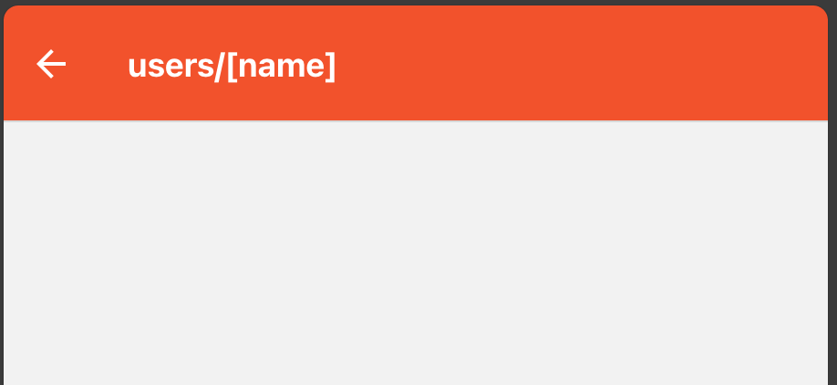

# Expo Router

Expo Router werkt zeer gelijkaardig aan de routing in next.js. Het is een file-based router. Dit wil zeggen dat je een mapstructuur aanmaakt en dat je op basis van de bestandsnaam de route bepaalt. Het laat toe om navigatie tussen schermen in je app te beheren, waardoor gebruikers naadloos tussen verschillende delen van de UI van je app kunnen bewegen, met behulp van dezelfde componenten op meerdere platforms (Android, iOS en web).

Het is gebaseerd op [React Navigation](https://reactnavigation.org/), een populaire library voor het beheren van navigatie in React Native apps. Expo Router bevat een eigen, ingebouwde versie daarvan: je hoeft dus geen `@react-navigation`-packages te installeren.

## Installatie

Je hoeft Expo Router niet apart te installeren. Een nieuw project dat je aanmaakt met `npx create-expo-app@latest` gebruikt standaard al Expo Router. Kies bij de vraag naar de SDK-versie altijd **Latest** en verwijder daarna de voorbeeldcode met `npm run reset-project` (antwoord `n`). Zie [Nieuwe app aanmaken](../expo/index.md#nieuwe-app-aanmaken).

## Schermen toevoegen

Als een bestand wordt aangemaakt in de `app` directory (in een nieuw project is dat `src/app`), wordt het automatisch een route in de app. In de voorbeelden hieronder schrijven we kortweg `app/...`. Bijvoorbeeld, de volgende bestanden zullen de volgende routes maken:
- `app/index.tsx` komt overeen met `/`
- `app/home.tsx` komt overeen met `/home`
- `app/settings/index.tsx` komt overeen met `/settings`
- `app/[user].tsx` komt overeen met dynamische paden zoals `/expo` of `/joske`

Deze paden kunnen worden gebruikt in de `Link` component om te navigeren naar een bepaald scherm. Als je de applicatie op een webbrowser opent, kan je ook de URL aanpassen om naar een bepaald scherm te navigeren.

### Het eerste scherm

In een nieuw project staan de schermen in de map `src/app`. Na `npm run reset-project` vind je daar het bestand `index.tsx`. Dit bestand wordt gebruikt als eerste scherm van je applicatie, op de route `/`.

```tsx
import React from "react";
import { View, StyleSheet, Text } from "react-native";

const Index = () => {
    return (
        <View style={styles.container}>
            <Text>Home Screen</Text>
        </View>
    )
}

const styles = StyleSheet.create({
    container: {
        flex: 1,
        justifyContent: "center",
        alignItems: "center"
    }
})

export default Index;
```

Als je de applicatie opstart met `npx expo start`, dan zie je dit scherm.

### Nog een scherm toevoegen

Willen we een tweede scherm toevoegen voor een bepaalde route dan maken we een bestand aan in de `app` directory met de naam van de route. Bijvoorbeeld `app/about.tsx` voor de route `/about`. 

```tsx
import React from "react";

import { View, StyleSheet, Text } from "react-native";

const About = () => {
    return (
        <View style={styles.container}>
            <Text>About Screen</Text>
        </View>
    )
}

const styles = StyleSheet.create({
    container: {
        flex: 1,
        justifyContent: "center",
        alignItems: "center"
    }
})

export default About;
```

### Dynamische routes

Je kan ook dynamische routes maken. Dit doe je door een bestand aan te maken met de naam van de route en tussen vierkante haken de naam van de parameter. Bijvoorbeeld `app/users/[name].tsx` voor de route `/users/expo` of `/users/joske`. 

```tsx
import { useLocalSearchParams } from "expo-router";
import React from "react";
import { View, StyleSheet, Text } from "react-native";

const User = () => {
    const { name } = useLocalSearchParams<{name: string}>();
    return (
        <View style={styles.container}>
            <Text>User : { name }</Text>
        </View>
    )
}

const styles = StyleSheet.create({
    container: {
        flex: 1,
        justifyContent: "center",
        alignItems: "center"
    }
})

export default User;
```

## Navigeren tussen schermen

Expo Router gebruikt het `Link` component om te navigeren tussen schermen. Dit component heeft een `href` property die de route bepaalt. 

```tsx
<Link href="/about">About</Link>
```

Het Link component wrapt de children in een `<Text>` component. Dit is handig voor accessibility maar niet altijd gewenst. Je kan het component aanpassen door de `asChild` property te gebruiken. Deze property zal alle props doorgeven aan het eerste child van het Link component. Het child component moet de `onPress` en `onClick` props ondersteunen. 

```tsx
<Link href="/about" asChild>
  <Button title="About" />
</Link>
```

of gebruik makende van de `Pressable` component:

```tsx
<Link href="/about" asChild>
  <Pressable>
    <Text>About</Text>
  </Pressable>
</Link>
```

### Imperatief navigeren

Je kan ook imperatief (via programma code) navigeren. Bijvoorbeeld als je een formulier hebt en je wil na het indienen van het formulier naar een andere pagina navigeren. 

```tsx
import { router } from 'expo-router';
...
router.replace("/about");
...
```

Op het router object kan je de volgende methodes gebruiken:
- `push` : voegt een nieuwe pagina toe aan de navigatie stack
- `replace` : vervangt de huidige pagina in de navigatie stack
- `back` : gaat terug naar de vorige pagina in de navigatie stack
- `canGoBack`: geeft aan of er een vorige pagina is in de navigatie stack
- `dismissAll`: gaat terug naar de eerste pagina van de navigatie stack
- `setParams`: verandert de parameters van de huidige pagina in de navigatie stack

### Dynamische routes linken

Je kan een link naar een dynamische route maken door de parameter in een template literal in de route te zetten:

```tsx
<Link href={`/users/${name}`}>View user</Link>
```

Of je kan hiervoor een `Href` object gebruiken:

```tsx
<Link
  href={{
    pathname: "/users/[name]",
    params: { name: 'bacon' }
  }}>
    View user
</Link>
```

:::info Typed routes
In een nieuw project staan *typed routes* aan. TypeScript kent dan alle routes in je `app`-map en geeft een fout als je naar een route linkt die niet bestaat. Daarom werkt `href={"/users/" + name}` niet: het resultaat is een gewone `string`, en TypeScript kan niet nagaan of dat een geldige route is. Met een template literal (`` `/users/${name}` ``) of een `Href` object lukt dat wel.

De types worden bijgewerkt terwijl `npx expo start` draait. Krijg je een fout op een route die je net aanmaakte, start dan eerst de development server.
:::

### Route vervangen

Per default worden routes toegevoegd aan de navigatie stack. Dit betekent dat de vorige pagina beschikbaar is als de gebruiker terug navigeert. Je kan de `replace` property gebruiken om de huidige pagina te vervangen in plaats van een nieuwe toe te voegen. 

```tsx
<Link href="/about" replace>
  <Text>About</Text>
</Link>
```

## Layout routes

Normaal gezien vult een route het volledige scherm. Als je tussen schermen navigeert is dit een volledige pagina transitie zonder animatie. In native apps verwachten gebruikers dat gedeelde elementen zoals headers en tab bars behouden blijven tussen pagina's. Deze worden gemaakt met behulp van layout routes.

### Layout route aanmaken

Om een layout route aan te maken maak je een bestand aan met de naam `_layout.tsx` in de app directory. 

```tsx
import { Slot } from 'expo-router';

const HomeLayout = () => {
  return <Slot />;
}

export default HomeLayout;
```

In het voorbeeld hierboven zal de `Slot` component de huidige child route renderen. Dit is vergelijkbaar met de `children` prop in React. Deze component kan gewrapt worden met andere componenten om een layout te maken.

```tsx
import { Slot } from 'expo-router';
import { Text } from 'react-native';
import { SafeAreaView } from 'react-native-safe-area-context';

const HomeLayout = () => {
  return (
    <SafeAreaView style={{ flex: 1 }}>
      <Text>Header</Text>
      <Slot />
      <Text>Footer</Text>
    </SafeAreaView>
  );
}

export default HomeLayout;
```

Twee dingen zijn hier belangrijk:
- De layout moet `flex: 1` hebben. Je schermen gebruiken zelf `flex: 1` om de beschikbare ruimte te vullen. Heeft de layout rond de `Slot` geen hoogte, dan is er geen ruimte om te vullen en blijft je scherm onzichtbaar.
- Een `Slot` tekent geen header, dus niets houdt je inhoud weg van de statusbalk bovenaan. De `SafeAreaView` zorgt ervoor dat de header en footer niet achter de statusbalk of de home-indicator verdwijnen.

Expo Router ondersteunt slechts één layout route per directory. Als je meerdere layout routes wil gebruiken moet je meerdere directories aanmaken. 

```
- app
  - _layout.tsx
  - home
    - _layout.tsx
    - index.tsx
```

Het nadeel hiervan is dat het pad hierdoor "vervuild" wordt met overbodige directories. Je kan dit probleem oplossen door een deel van de directory structuur te verbergen door een deel van het pad te omringen met ronde haakjes. 

- `app/root/home.tsx` komt overeen met `/root/home`
- `app/(root)/home.tsx` komt overeen met `/home`

Dit is handig om layouts toe te voegen zonder extra segmenten aan de URL toe te voegen. Je kan zoveel groepen toevoegen als je wil.

## Native layouts

Uiteraard wordt er niet vaak gebruik gemaakt van eigen layouts en wordt er vooral gebruik gemaakt van de ingebouwde native layouts van het platform. Expo Router ondersteunt de volgende native layouts:

- Stack Navigation (met modals)
- Tab Navigation
- Drawer Navigation

### Stack Navigation

Stack Navigation is de meest gebruikte layout. Het is een layout waarbij de schermen op elkaar gestapeld worden. Je kan navigeren naar een volgend scherm en terugkeren naar het vorige scherm. 

Om de schermen te stacken moet je het `_layout.tsx` bestand aanpassen en een `Stack` component gebruiken.

```tsx
import { Stack } from 'expo-router';

const HomeLayout = () => {
  return (
    <Stack/>
  );
}

export default HomeLayout;
```

#### Configuratie

Je kan de header van de schermen aanpassen door de `screenOptions` property te gebruiken van het `Stack` component. 

```tsx
<Stack
    screenOptions={{
      headerStyle: {
        backgroundColor: '#f4511e',
      },
      headerTintColor: '#fff',
      headerTitleStyle: {
        fontWeight: 'bold',
      },
    }}
/>
```



Je kan als children van het `Stack` component de schermen individueel configureren door ze `Stack.Screen` componenten te gebruiken. Dit is handig om bijvoorbeeld de titel van de header aan te passen. 

```tsx
<Stack
    screenOptions={{
    headerStyle: {
        backgroundColor: '#f4511e',
    },
    headerTintColor: '#fff',
    headerTitleStyle: {
        fontWeight: 'bold',
    },
    }}
    
>
    <Stack.Screen name="index" options={{title: "Home"}}></Stack.Screen>
    <Stack.Screen name="users/[name]" options={{title: "User"}}></Stack.Screen>
</Stack>
```

Hierboven gaan we dus de titel van de header aanpassen voor de home pagina en de dynamische route.

Het is ook mogelijk om het `Stack.Screen` component te gebruiken in het component zelf. Dus in plaats van de `Stack` component te gebruiken in het `_layout.tsx` bestand kan je het `Stack.Screen` component gebruiken in het `index.tsx` bestand. 

```tsx
const Index = () => {
    return (
        <View style={styles.container}>
            <Stack.Screen options={{title: "Home"}}></Stack.Screen>
            <Text>Home Screen</Text>
        </View>
    )
}
```

Dit maakt het mogelijk om de header iets dynamischer te maken met informatie uit de pagina. Dit is bijvoorbeeld interessant voor pagina's met dynamische routes. 

```tsx
const User = () => {
    const { name } = useLocalSearchParams<{name: string}>();
    return (
        <View style={styles.container}>
            <Stack.Screen options={{title: "User: " + name}}></Stack.Screen>
            <Text>User : { name }</Text>
        </View>
    )
}
```

Omdat Expo Router gebaseerd is op React Navigation, kan je alle mogelijke opties voor het `Stack.Screen` component [hier](https://reactnavigation.org/docs/native-stack-navigator/#options) terugvinden.

#### Animation

Je kan de animatie van de transitie tussen schermen aanpassen door de `animation` property mee te geven in het options object van het `Stack.Screen` component. 

```tsx
<Stack.Screen
  name="index"
  options={{
    animation: 'slide_from_right',
  }}
  />
```

De volgende animaties zijn beschikbaar:
- `default` : de standaard animatie
- `fade` : fade in en fade out
- `slide_from_right` : slide in van rechts en slide out naar rechts
- `slide_from_left` : slide in van links en slide out naar links
- `slide_from_bottom` : slide in van onder en slide out naar onder
- `none`: geen animatie
- meer animaties zijn beschikbaar in de [documentatie](https://reactnavigation.org/docs/native-stack-navigator#animation)

#### Modals

Een modal is een scherm dat over het vorige scherm schuift, bijvoorbeeld een formulier om iets toe te voegen. Je maakt een modal door in een `Stack` de `presentation` optie van een scherm op `'modal'` te zetten:

```tsx
<Stack>
    <Stack.Screen name="index" options={{ title: "Home" }} />
    <Stack.Screen name="add" options={{ presentation: 'modal', title: "Toevoegen" }} />
</Stack>
```

Navigeer je nu naar `/add`, dan schuift dat scherm van onder over het huidige scherm. Op iOS kan de gebruiker de modal sluiten door ze naar beneden te vegen. Vanuit je code sluit je ze met `router.back()`.

### Tab Navigation

Bij een Tab Navigation staat er onderaan het scherm een tab bar. Elke tab is een scherm, en met een tik op een tab wissel je van scherm. We gebruiken hiervoor **Native Tabs**: dat is de tab bar van het platform zelf. Op iOS krijg je de echte iOS tab bar (met het Liquid Glass-uiterlijk vanaf iOS 26), op Android de Material Design tab bar.

Om een Tab Navigation te gebruiken moet je het `_layout.tsx` bestand aanpassen en een `NativeTabs` component gebruiken uit `expo-router/native-tabs`.

```tsx
import { NativeTabs } from 'expo-router/native-tabs';

const TabLayout = () => {
  return (
    <NativeTabs>
      <NativeTabs.Trigger name="index">
        <NativeTabs.Trigger.Label>Home</NativeTabs.Trigger.Label>
        <NativeTabs.Trigger.Icon sf="house.fill" md="home" />
      </NativeTabs.Trigger>
      <NativeTabs.Trigger name="about">
        <NativeTabs.Trigger.Label>About</NativeTabs.Trigger.Label>
        <NativeTabs.Trigger.Icon sf="info.circle" md="info" />
      </NativeTabs.Trigger>
    </NativeTabs>
  );
}

export default TabLayout;
```

Elke tab is een `NativeTabs.Trigger`. Met de `name` property bepaal je welk scherm (welk bestand in de map) bij de tab hoort. Daarbinnen kan je instellen hoe de tab eruitziet:
- `NativeTabs.Trigger.Label`: de tekst onder het icoon. Laat je die weg, dan wordt de naam van de route gebruikt.
- `NativeTabs.Trigger.Icon`: het icoon van de tab. Met `sf` kies je het icoon op iOS, met `md` het icoon op Android.
- `NativeTabs.Trigger.Badge`: een badge op de tab, bijvoorbeeld het aantal ongelezen berichten: `<NativeTabs.Trigger.Badge>3</NativeTabs.Trigger.Badge>`.

:::warning Enkel schermen met een Trigger
Een scherm komt enkel in de tab bar als je er een `NativeTabs.Trigger` voor maakt. Een bestand in de map zonder `Trigger` krijgt geen tab en je kan er ook niet naartoe navigeren: een link naar dat scherm doet niets. Op Android kan je maximaal 5 tabs gebruiken.
:::

Native Tabs tonen geen header bovenaan het scherm. Wil je toch een header, dan zet je een Stack in de tab (zie [Een Stack in een tab](#een-stack-in-een-tab)).

#### Iconen

Elk platform heeft zijn eigen set iconen. Daarom geef je per platform de naam van een icoon mee:
- `sf`: een **SF Symbol**, de iconen van Apple voor iOS. Je vindt ze in de gratis [SF Symbols app](https://developer.apple.com/sf-symbols/) (enkel voor macOS).
- `md`: een **Material Symbol**, de iconen van Google voor Android. Je kan ze opzoeken op [fonts.google.com/icons](https://fonts.google.com/icons). Gebruik de naam in kleine letters met underscores, bv. `account_circle`.

Je hoeft de namen niet uit het hoofd te kennen. Beide properties zijn getypeerd: typ in VS Code `sf="house` en je krijgt een lijst met alle iconen die beginnen met `house`. Een naam die niet bestaat (bv. `sf="info.circel"`) geeft meteen een TypeScript-fout. Zo vind je ook zonder Mac een SF Symbol.

Je hebt hiervoor geen extra package nodig. Je kan ook voor de geselecteerde tab een ander icoon kiezen:

```tsx
<NativeTabs.Trigger.Icon
  sf={{ default: 'house', selected: 'house.fill' }}
  md={{ default: 'home', selected: 'home_filled' }}
/>
```

#### Een tab verbergen

Met de `hidden` property verberg je een tab uit de tab bar:

```tsx
<NativeTabs.Trigger name="about" hidden />
```

Een verborgen tab is helemaal niet meer bereikbaar, ook niet via een `Link` of `router.push`. Wil je een scherm dat wel bereikbaar is maar geen eigen tab heeft (zoals een detailpagina), gebruik dan een Stack in een tab.

#### Een Stack in een tab

Vaak wil je vanuit een tab doorklikken naar een detailpagina, bijvoorbeeld van een lijst met gebruikers naar de pagina van één gebruiker. De tab bar moet dan blijven staan, en de detailpagina heeft een header met een terugknop.

Dat doe je door de schermen van die tab in een eigen map te zetten met een eigen `_layout.tsx` die een `Stack` gebruikt:

```
- app
  - _layout.tsx        (NativeTabs)
  - index.tsx
  - about.tsx
  - users
    - _layout.tsx      (Stack)
    - index.tsx
    - [name].tsx
```

In de `NativeTabs` verwijs je naar de map `users`:

```tsx
import { NativeTabs } from 'expo-router/native-tabs';

const TabLayout = () => {
  return (
    <NativeTabs>
      <NativeTabs.Trigger name="index">
        <NativeTabs.Trigger.Label>Home</NativeTabs.Trigger.Label>
        <NativeTabs.Trigger.Icon sf="house.fill" md="home" />
      </NativeTabs.Trigger>
      <NativeTabs.Trigger name="users">
        <NativeTabs.Trigger.Label>Users</NativeTabs.Trigger.Label>
        <NativeTabs.Trigger.Icon sf="person.2.fill" md="group" />
      </NativeTabs.Trigger>
      <NativeTabs.Trigger name="about">
        <NativeTabs.Trigger.Label>About</NativeTabs.Trigger.Label>
        <NativeTabs.Trigger.Icon sf="info.circle" md="info" />
      </NativeTabs.Trigger>
    </NativeTabs>
  );
}

export default TabLayout;
```

De `users/_layout.tsx` maakt van de tab een Stack:

```tsx
import { Stack } from 'expo-router';

const UsersLayout = () => {
  return (
    <Stack>
      <Stack.Screen name="index" options={{ title: "Users" }} />
    </Stack>
  );
}

export default UsersLayout;
```

En `users/index.tsx` toont de lijst met links naar de detailpagina:

```tsx
import { Link } from "expo-router";
import { View, StyleSheet } from "react-native";

const users = ["bacon", "joske", "expo"];

const Users = () => {
    return (
        <View style={styles.container}>
            {users.map(name => (
                <Link key={name} href={`/users/${name}`}>{name}</Link>
            ))}
        </View>
    )
}

const styles = StyleSheet.create({
    container: {
        flex: 1,
        justifyContent: "center",
        alignItems: "center",
        gap: 12
    }
})

export default Users;
```

De `users/[name].tsx` is de pagina uit [Dynamische routes](#dynamische-routes). Tik je op een naam, dan schuift de detailpagina binnen de tab, met een header en een terugknop naar `Users`. De tab bar blijft staan.

:::info JavaScript tabs
Naast Native Tabs heeft Expo Router ook tabs die volledig in JavaScript getekend worden (`import { Tabs } from 'expo-router/js-tabs'`). Die kan je vrijer stijlen, maar ze zien er niet uit als de tab bar van het platform. In deze cursus gebruiken we Native Tabs.
:::

### Drawer Navigation

Om een Drawer Navigation te gebruiken moet je het `_layout.tsx` bestand aanpassen en een `Drawer` component gebruiken.

```tsx
import { Drawer } from 'expo-router/drawer';

const Layout = () => {
  return (
    <Drawer>
      <Drawer.Screen
        name="index"
        options={{
          title: 'Home',
        }}
      />
      <Drawer.Screen
        name="about"
        options={{
          title: 'About',
        }}
      />
    </Drawer>
  );
}

export default Layout;
```

Net zoals bij Native Tabs zijn enkel de schermen die je met `Drawer.Screen` toevoegt bereikbaar. Je kan nog meer opties voor het `Drawer.Screen` component [hier](https://reactnavigation.org/docs/drawer-navigator/#options) terugvinden.

### Combineren van layouts

Je kan layouts combineren door in een map een andere layout te gebruiken dan in de map erboven. Stel dat je app opent met een welkomstscherm zonder tab bar, en dat je na een tik op een knop in een deel van de app met een tab bar komt.

De structuur van de directory ziet er dan als volgt uit:

```
- app
  - _layout.tsx        (Stack)
  - index.tsx          (welkomstscherm)
  - home
    - _layout.tsx      (NativeTabs)
    - index.tsx
    - profile.tsx
```

De `_layout.tsx` in de `app` directory is een Stack zonder headers:

```tsx
import { Stack } from 'expo-router';

const Layout = () => {
  return (
    <Stack screenOptions={{ headerShown: false }}>
      <Stack.Screen name="index" />
      <Stack.Screen name="home" />
    </Stack>
  );
}

export default Layout;
```

Het welkomstscherm `index.tsx` linkt naar `/home`. Door `replace` kan de gebruiker niet terug naar het welkomstscherm:

```tsx
import { View, Text, Button } from 'react-native';
import { Link } from 'expo-router';

const Welcome = () => {
  return (
    <View style={{ flex: 1, alignItems: 'center', justifyContent: 'center' }}>
      <Text style={{ fontWeight: "bold", fontSize: 24 }}>Welcome to the app</Text>
      <Text style={{ fontWeight: "100", marginBottom: 20 }}>This is a dummy text</Text>
      <Link href="/home" replace asChild>
        <Button title="Start" />
      </Link>
    </View>
  );
}

export default Welcome;
```

De `home/_layout.tsx` maakt van de map `home` een Tab Navigation:

```tsx
import { NativeTabs } from 'expo-router/native-tabs';

const HomeLayout = () => {
  return (
    <NativeTabs>
      <NativeTabs.Trigger name="index">
        <NativeTabs.Trigger.Label>Home</NativeTabs.Trigger.Label>
        <NativeTabs.Trigger.Icon sf="house.fill" md="home" />
      </NativeTabs.Trigger>
      <NativeTabs.Trigger name="profile">
        <NativeTabs.Trigger.Label>Profiel</NativeTabs.Trigger.Label>
        <NativeTabs.Trigger.Icon sf="person.crop.circle" md="account_circle" />
      </NativeTabs.Trigger>
    </NativeTabs>
  );
}

export default HomeLayout;
```

Omdat het eerste tabblad `home/index.tsx` heet, hoort het bij de route `/home`. Zo kan de link op het welkomstscherm gewoon naar `/home` gaan. De `home/index.tsx`:

```tsx
import { View, Text } from "react-native";

const Home = () => {
    return (
        <View style={{ flex: 1, alignItems: 'center', justifyContent: 'center' }}>
            <Text style={{ fontWeight: "bold", fontSize: 24 }}>Home</Text>
        </View>
    );
}

export default Home;
```

De `home/profile.tsx` ziet er hetzelfde uit, met de tekst `Profiel`.

## useFocusEffect

Bij een Stack of Tab Navigation blijven schermen bestaan als je naar een ander scherm navigeert. Ga je bijvoorbeeld naar een ander tabblad en kom je daarna terug, dan wordt het eerste scherm niet opnieuw aangemaakt. Het was gewoon even niet zichtbaar.

Dat heeft een gevolg voor `useEffect`. Een `useEffect` met een lege dependency array wordt maar één keer uitgevoerd: de eerste keer dat het scherm getoond wordt. Keer je later terug naar het scherm, dan wordt die niet opnieuw uitgevoerd.

Meestal is dat precies wat je wil, maar niet altijd. Stel dat je op het ene scherm een lijst toont en op een ander scherm een item aan die lijst toevoegt. Als je terugkeert naar de lijst, wil je die opnieuw ophalen zodat het nieuwe item erbij staat.

Hiervoor heeft Expo Router de `useFocusEffect` hook. Deze werkt zoals `useEffect`, maar wordt uitgevoerd telkens het scherm in beeld komt (de focus krijgt). Net zoals bij `useEffect` kan je een cleanup functie teruggeven. Die wordt uitgevoerd telkens het scherm uit beeld gaat. Dat is handig om bijvoorbeeld een timer te stoppen.

```tsx
import React, { useCallback, useEffect } from "react";
import { View, Text, StyleSheet } from "react-native";
import { useFocusEffect } from "expo-router";

const Index = () => {
    useEffect(() => {
        console.log("useEffect: scherm aangemaakt");
    }, []);

    useFocusEffect(
        useCallback(() => {
            console.log("useFocusEffect: scherm in beeld");

            return () => {
                console.log("useFocusEffect: scherm uit beeld");
            };
        }, [])
    );

    return (
        <View style={styles.container}>
            <Text>Home Screen</Text>
        </View>
    )
}

const styles = StyleSheet.create({
    container: {
        flex: 1,
        justifyContent: "center",
        alignItems: "center"
    }
})

export default Index;
```

Zet dit scherm in een Tab Navigation met nog een tweede tabblad en wissel een paar keer van tabblad. In de terminal waar je `npx expo start` uitvoerde zie je dat `useEffect` maar één keer iets logt, terwijl `useFocusEffect` dat telkens opnieuw doet als je terugkeert.

### useCallback

Misschien viel het je op dat we de functie niet rechtstreeks aan `useFocusEffect` meegeven, maar eerst in `useCallback` wikkelen. Dat is nodig omdat `useFocusEffect` de functie opnieuw uitvoert telkens hij een **andere** functie binnenkrijgt.

Bij elke render van je component wordt een arrow function opnieuw aangemaakt. Voor JavaScript is dat telkens een nieuwe functie, ook al staat er exact dezelfde code in. Zonder `useCallback` zou het effect dus na elke render opnieuw uitgevoerd worden in plaats van enkel wanneer het scherm in beeld komt. Pas je in het effect de state aan, dan krijg je zelfs een oneindige lus.

`useCallback` lost dat op: het onthoudt de functie tussen de renders door en geeft telkens dezelfde functie terug. Enkel als een waarde in de dependency array verandert, wordt er een nieuwe functie gemaakt. Die dependency array werkt dus net zoals bij `useEffect`: gebruik je in de functie een waarde die kan veranderen (bv. een parameter uit `useLocalSearchParams`), dan zet je die in de array.

### Data opnieuw ophalen

Het meest gebruikte voorbeeld van `useFocusEffect` is data opnieuw ophalen als je terugkeert naar een scherm. Net zoals bij `useEffect` mag de functie zelf niet `async` zijn. Daarom maken we binnenin een aparte async functie die we meteen oproepen.

```tsx
const [todos, setTodos] = useState<Todo[]>([]);

useFocusEffect(
    useCallback(() => {
        const loadTodos = async () => {
            // haal hier de todos opnieuw op (bv. uit AsyncStorage of Supabase)
            // en zet ze in de state met setTodos(...)
        };

        loadTodos();
    }, [])
);
```
