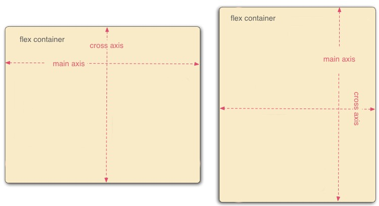

import InteractiveFlexbox from '@site/src/components/InteractiveFlexbox';
import HyperframesVideo from '@site/src/components/HyperframesVideo';

# Flexbox

<HyperframesVideo name="react-native-flexbox" title="React Native - Flexbox uitgelegd" />

## Flexbox in React Native

React Native ondersteunt flexbox. Flexbox is een manier om de layout van je app te bepalen. Je kan flexbox gebruiken om de positie van elementen te bepalen, maar ook om de grootte van elementen te bepalen. Het is ontworpen om een consistente layout aan te bieden voor verschillende scherm groottes.

 In React Native zijn alle elementen by default flexbox elementen. Het is dus belangrijk om te weten hoe flexbox werkt. Het is zeer gelijkaardig met flexbox voor css op web. Met wat uitzonderingen.

## Flex Properties

### Flex Direction

Met flexDirection kan je de primaire as van de layout bepalen. 

Er zijn twee assen in flexbox: de main axis en de cross axis:
- De main axis is de richting waarin flex items worden geplaatst. 
- De cross axis is de richting die loodrecht staat op de main axis.

  

Als je flexDirection op **row** zet, dan zal de main axis horizontaal zijn. Dit wil zeggen dat alle items naast elkaar zullen staan.

Als je flexDirection op **column** zet, dan zal de main axis vertikaal zijn. Dit wil zeggen dat alle items onder elkaar zullen staan.

By **default** is de flexDirection **column**, maar bij web is dat row. Mobile apps zijn meer verticaal gericht.

Andere mogelijkheden zijn: `column-reverse` en `row-reverse`. Deze werken hetzelfde als `column` en `row`, maar de items worden dan in omgekeerde volgorde geplaatst.

In de voorbeelden op deze pagina pas je de code zelf aan: het scherm en de main en cross axis volgen meteen. Klik in een waarde zoals `"row"` om alle mogelijkheden te zien.

<InteractiveFlexbox preset="flexDirection" />

### Flex 

Flex geeft aan hoe de items van de container zich moeten verhouden tot de andere items in de container. De items gaan "vechten" om de ruimte in de container. Hoe meer flex een item heeft, hoe meer ruimte het zal krijgen.

Meestal zetten we de hoofdcontainer op flex: 1. Dit zorgt ervoor dat de container de volledige ruimte inneemt. 

Hier is een voorbeeld van een container met 3 items. De eerste heeft flex: 1, de tweede heeft flex: 2 en de derde heeft flex: 3. De derde item zal dus 3 keer zo groot zijn als de eerste.

<InteractiveFlexbox preset="flex" />

### justifyContent

justifyContent bepaalt de verspreiding van de children over de main axis. 

De mogelijkheden zijn:
- `flex-start`: de items worden aan de start van de main axis geplaatst.
- `flex-end`: de items worden aan het einde van de main axis geplaatst.
- `center`: de items worden in het midden van de main axis geplaatst.
- `space-between`: de items worden verspreid over de main axis. De eerste en laatste item staan aan de start en het einde van de main axis.
- `space-around`: de items worden verspreid over de main axis. Elk item krijgt evenveel ruimte links en rechts (of boven en onder), waardoor de ruimte aan de randen half zo groot is als tussen de items.
- `space-evenly`: de items worden verspreid over de main axis. Er is evenveel ruimte tussen de items en de start en het einde van de main axis.

Default: `flex-start`

<InteractiveFlexbox preset="justifyContent" />

# alignItems

alignItems bepaalt hoe de items worden uitgelijnd over de cross axis.

De mogelijkheden zijn:
- `flex-start`: de items worden aan de start van de cross axis geplaatst.
- `flex-end`: de items worden aan het einde van de cross axis geplaatst.
- `center`: de items worden in het midden van de cross axis geplaatst.
- `stretch`: de items worden uitgerekt om de volledige hoogte van de container te vullen. Dit werkt enkel als de relevante grootte van de items niet expliciet is gezet.

Default: `stretch`

<InteractiveFlexbox preset="alignItems" />

# alignSelf

Als je een item wilt uitlijnen op een andere manier dan de rest van de items, dan kan je align self gebruiken. 

<InteractiveFlexbox preset="alignSelf" />

# flexWrap

Flex wrap bepaalt of de items op meerdere regels moeten worden weergegeven als ze niet op de main axis passen.

De mogelijkheden zijn:
- `nowrap`: de items worden niet op meerdere regels weergegeven.
- `wrap`: de items worden op meerdere regels weergegeven.
- `wrap-reverse`: zoals `wrap`, maar de regels worden in omgekeerde volgorde over de cross axis geplaatst.

Default: `nowrap`

alignContent bepaalt hoe de regels worden uitgelijnd over de cross axis als er meerdere regels zijn. Dit werkt enkel als flexWrap op `wrap` of `wrap-reverse` staat. De mogelijkheden zijn dezelfde als bij justifyContent, aangevuld met `stretch`.

Default: `flex-start` (op het web is dat `stretch`)

Voeg items toe of verwijder ze en kijk wanneer ze naar een nieuwe regel springen.

<InteractiveFlexbox preset="flexWrap" />

## Absolute positioning

Absolute positioning is een manier om de positie van een element te bepalen. Je moet hier zelf rekening houden met bepaalde schermgroottes.

Je gebruikt hier de properties `top`, `bottom`, `left` en `right` om de positie van het element te bepalen.

<InteractiveFlexbox preset="absolute" />

## Speeltuin

Combineer alles: pas de parent aan, voeg Views toe of verwijder ze en geef elk kind zijn eigen flex, grootte en positie.

<InteractiveFlexbox preset="playground" />
